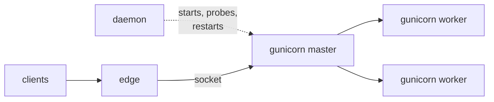
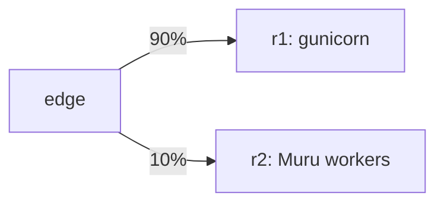

# Moving a deployment to Muru a step at a time

Changing the server an application runs on is a risk of its own, apart
from any change to the application: different defaults, different
timeouts, different behaviour under load. The safe way is the way any
risky release goes out: beside the old one, a share of the traffic at
a time, with a quick way back.

## A managed server release



The Muru daemon can run a release that is not Muru's own workers but
an ordinary HTTP server, with `kind = 'http'`. You give it the command
you deploy with today, with `{bind}` where the address goes, and a
profile that says how that server binds and stops: `gunicorn`,
`uvicorn`, `granian`, `mod_wsgi-express` or `generic`.

```console
muructl deploy orders orders --server gunicorn -- \
    gunicorn --workers 2 --bind '{bind}' orders:application
```

The daemon starts the command with an address of its own, a Unix
socket under the release's run directory, waits until it answers,
restarts it if it exits, and stops it with the profile's signal when
the release drains. The edge sends it requests as it would any
upstream server, with the forwarding headers added. Nothing about the
application or its gunicorn settings changes.

## Then a native release, a share at a time



The release is a release like any other. The same application can be
deployed again as Muru's own workers, held without traffic, previewed,
and canaried against the gunicorn release, with the gates judging the
Muru release against gunicorn's numbers over the same requests. If it
does worse, it is rolled back on its own. Once it is promoted, the
gunicorn release is kept warm like any replaced release, and a
rollback to it is instant.

Nothing in the routes or the hosts changes along the way, and clients
see one address throughout.

## When to choose which

Muru runs what you already have, so the choice need not be made all at
once. Each server has its strengths:

- **gunicorn** is the long-standing default for WSGI, simple and well
  understood, behind a proxy that does the edge's work.

- **uvicorn** is the usual server for ASGI applications, and
  **Granian** serves WSGI, ASGI or its own RSGI interface, with the
  HTTP handling in Rust.

- **Apache with mod_wsgi** suits sites that already run Apache, and
  want it in front of their Python as well.

- **Muru** puts what usually takes a proxy, a process manager and a
  load balancer in one place: the edge in front, preloaded workers
  with an import check, WSGI and ASGI together, and releases side by
  side for deploys, canaries and rollbacks with no dropped requests.
