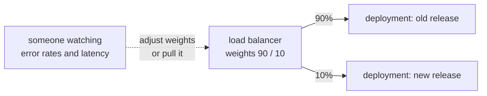
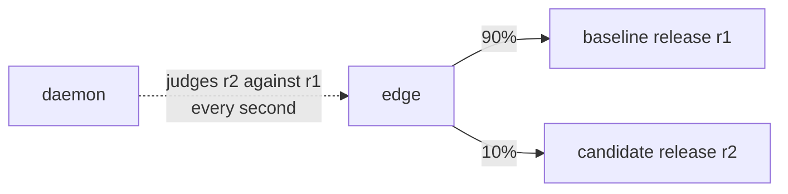

# Canary releases

A canary gives a new release a small share of the real traffic first,
watches how it does against the release that serves, and only then
gives it the rest. If it does worse, it is taken out again before most
users have seen it.

## The usual way

None of gunicorn, uvicorn, Granian or mod_wsgi has a notion of two
releases: each serves one version of the code. A canary is built
around them: a second deployment for the new release, a load balancer
or service mesh that can split traffic by weight, and something that
compares the two, a person watching dashboards or a controller such as
those that run canaries on Kubernetes, and changes the weights or
pulls the canary.

## A rollout under the Muru daemon

The edge already routes to several releases of an application at
once, so a canary is a change of routing rather than a second
deployment:

- **Hold** a release: `muructl deploy --hold` starts it beside the
  serving one and gives it no traffic.

- **Preview** it: a request with the `Muru-Preview` header or the
  `muru_preview` cookie naming it goes to it, whatever the shares are.

- **Canary** it: `muructl rollout canary` gives it each share in
  `--steps` in turn, holding each for `--hold`. Clients are hashed to
  stable buckets by a cookie the edge issues, so a client in the canary
  at 10% is still in it at 50%.

- **Gates** judge it, every second once it has served `--min-requests`
  in the step: its 5xx rate (`--max-error-rate`, 1% by default), and
  optionally its latency, worker crashes and probes. A gate fails only
  when the candidate is over its limit and worse than the baseline over
  the same window, so a fault both share, such as a database outage,
  does not roll it back.

- **Promoted or rolled back**: when the last step passes, the candidate
  takes all the traffic and the baseline is kept warm. When a gate
  fails, the candidate leaves traffic at once and is kept warm itself,
  so its logs and workers can be looked at.

`muructl rollout status` says where a rollout stands and, when one
ended, why.
