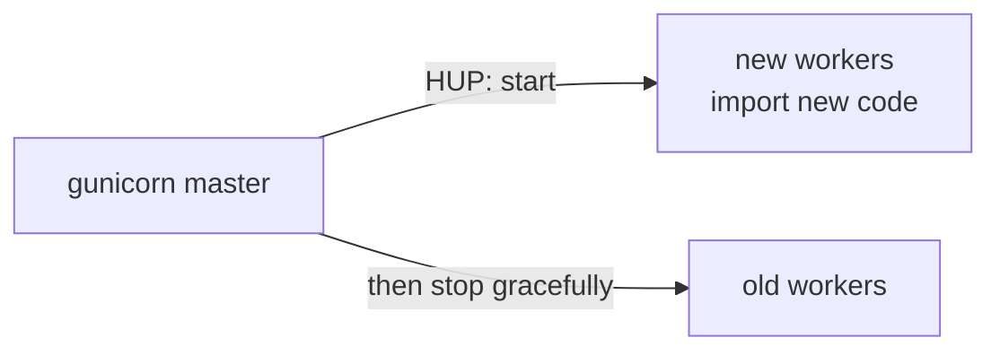
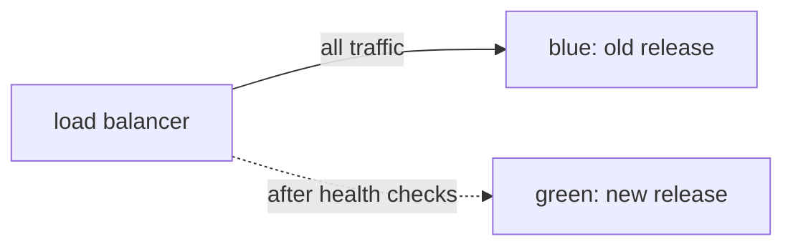
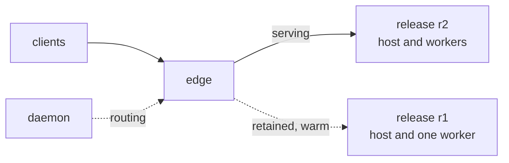

# Deploying new code

A deploy has to do three things: get the new code running, move the
requests over to it, and get rid of the old code. What can go wrong is
in the moves between them: requests that arrive while nothing is ready
to serve them, requests cut off in the middle, and no quick way back
when the new code turns out to be wrong.

## gunicorn

`HUP` tells the master to start new workers and gracefully stop the
old ones; the new workers import the application afresh, so they get
the new code. With `--preload`, the master already holds the old code
and the new workers are forked from it, so new code needs `USR2`
instead: a second master is started beside the first, and you stop
the old one once the new one is serving. There is no going back to the
old code except by deploying it again.

## Apache with mod_wsgi

In daemon mode, touching the WSGI script file, or restarting the
daemon processes, replaces them. The new processes import the code
again, and requests wait for them. Going back means putting the old
code in place and doing the same again.

## Two deployments behind a load balancer

The way to deploy without dropping requests, whatever the server, has
been to run the new release as a second deployment beside the first,
wait for its health checks, shift the load balancer to it, drain the
old one, and keep it around for a while in case you need to shift
back. That is two of everything, and a load balancer you can drive
from the deploy.

## The Muru daemon

The daemon does the second of those on one machine. A deploy starts
the new release, a host of its own that imports the new code and forks
its workers, beside the release that serves. When every worker is
ready, the daemon tells the edge to send new requests to the new
release. The old release finishes the requests it has, then is kept
warm, its host and one worker still running, for 30 minutes. A
rollback within that time moves the traffic back at once, and the old
release's worker count grows back by forking from its host.

The edge is a process of its own, holding the listening socket and
every client connection. The daemon, which decides what to do, is
never on the path of a request, and can be stopped and started again,
or upgraded, while the edge and the releases go on serving.

| | New code | During the switch | Going back |
| --- | --- | --- | --- |
| gunicorn | `HUP`, or `USR2` with `--preload` | old workers finish, new ones take over | deploy the old code again |
| mod_wsgi | restart the daemon processes | requests wait for the new processes | deploy the old code again |
| two deployments | a second deployment | the load balancer shifts | shift the load balancer back |
| Muru daemon | `muructl deploy` | the edge switches when the release is ready | `muructl rollback`, instant while warm |
