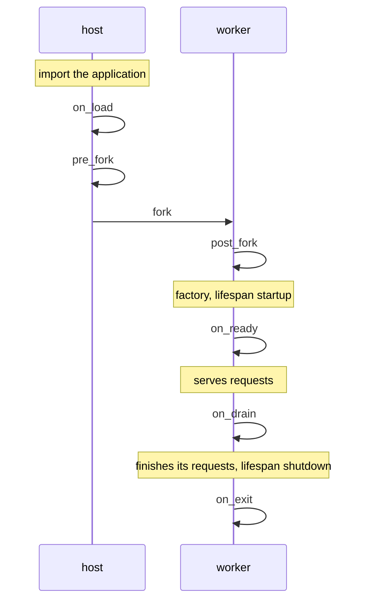

# Hooks from load to exit

A preforking server imports an application in one process and runs it
in others, and some work has to happen at a particular point in that:
a connection opened only after the fork, a buffer flushed before a
worker exits. Hooks are the server calling your code at those points.

## The servers

- gunicorn has server hooks, functions in `gunicorn.conf.py` such as
  `on_starting`, `when_ready`, `pre_fork`, `post_fork`,
  `post_worker_init`, `worker_exit`, `child_exit` and `on_exit`, some
  run in the arbiter and some in the workers.

- uvicorn has none of its own. An ASGI application's lifespan, run in
  each worker, is where startup and shutdown work goes.

- mod_wsgi's `WSGIImportScript` imports a script when a daemon process
  starts, before any request.

## Muru's seven hooks

A hooks module, named with `--hooks` or `hooks` in `[tool.muru]`, may
define any of seven functions. Each takes the context, which says
among other things which worker it is in: `worker_id` is `None` in the
host.

| Hook | Runs in | When |
| --- | --- | --- |
| `on_load` | the host | after the application is imported |
| `pre_fork` | the host | before the workers are forked |
| `post_fork` | each worker | just after it is forked |
| `on_ready` | each worker | when it is about to take requests |
| `on_drain` | each worker | when it is told to stop taking requests |
| `on_exit` | each worker | just before it exits |
| `on_reopen_logs` | a worker | when it receives `SIGUSR1` |

What each is for:

- `on_load` and `pre_fork`: work done once and shared by every worker
  through the fork, such as warming a cache, and closing anything that
  must not cross the fork.

- `post_fork`: anything a worker must own, such as a database pool, a
  client with a socket, or a background thread.

- `on_ready`: telling something outside that the worker serves.

- `on_drain` and `on_exit`: flushing what is buffered and closing
  connections cleanly.

- `on_reopen_logs`: reopening a log file the application opened
  itself, after the file was rotated. Under the daemon,
  `muructl logs reopen --workers` sends it to every worker.

When the import check finds the application unsafe to preload, or
`preload` is `false`, there is no shared import: each worker imports
the application itself and runs `on_load` and `pre_fork` before its
`post_fork`.

## Lifespan

An ASGI application's lifespan runs once in each worker too, between
`post_fork` and `on_ready` for startup and between `on_drain` and
`on_exit` for shutdown. A hook and the lifespan can do the same work;
the lifespan belongs to the application and goes wherever it is served,
while the hooks belong to how Muru serves it.
