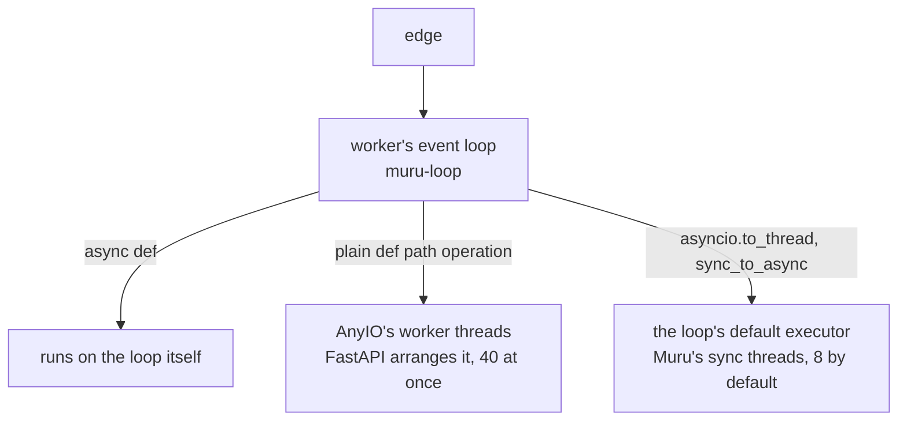

# FastAPI on an event loop

An ASGI server runs the application's requests as tasks on an asyncio
event loop. While one task awaits, the loop runs the others, so a
single thread holds many requests at once. The catch is the one rule
every task has to keep: never hold the loop without awaiting.

## Where each kind of code runs

- An `async def` path operation runs on the event loop. Everything it
  does between two `await`s holds every other request in the worker.

- A plain `def` path operation is handed to a thread by FastAPI, with
  AnyIO's `to_thread.run_sync`, so it may block. AnyIO lets 40 of
  them run at once by default; the rest wait for a thread.

- `asyncio.to_thread()`, and asgiref's `sync_to_async`, use the
  event loop's default executor. Under Muru that is a pool of
  `--sync-threads` threads, eight unless the project says otherwise,
  named `muru-sync_0` and on.

## The servers

- uvicorn runs one event loop per worker process, `--workers` of them,
  and `--limit-concurrency` caps the requests a worker holds. A loop
  that is blocked holds every request on it until the call returns;
  nothing watches for it.

- gunicorn with uvicorn's worker class runs the same loops under
  gunicorn's arbiter, which replaces a worker that stops sending its
  heartbeat for `--timeout` seconds.

- Muru runs one event loop per worker on a thread named `muru-loop`.
  `--concurrency` (1000 by default) is how many requests a worker
  holds on it at once; beyond that the edge queues them. The lifespan
  protocol runs once in each worker, before it takes a request.

## The loop stall timeout

Muru's loop beats twice a second, and a watchdog outside Python
notices when it has not beaten for the loop stall timeout, ten seconds
unless `--timeout loop_stall=` says otherwise. The worker is then
replaced as for a hard timeout: a new worker takes its place in
routing at once, and every request the stalled one held is answered
`502` with the reason `worker_stalled` there and then, since a loop
that does not run can finish none of them. The stalled worker is
given the hard drain grace (ten seconds) and the shutdown timeout
(five) to stop, and is then killed, with its threads' stacks in the
log.

The timeout limits how long a stalled loop goes on holding requests;
it does not save the requests on it. The fix is in the code: `await`
the asynchronous version of the call, or hand the blocking call to a
thread with `asyncio.to_thread`, or make the path operation a plain
`def`.
