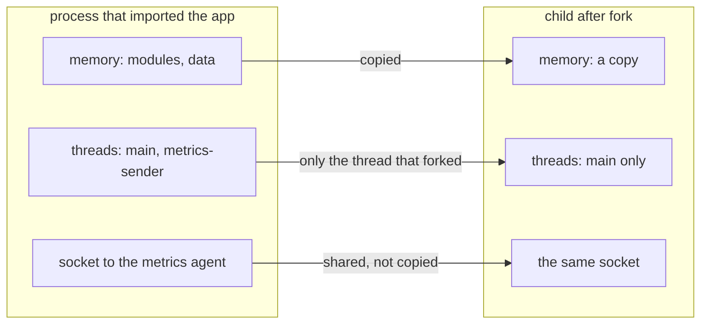
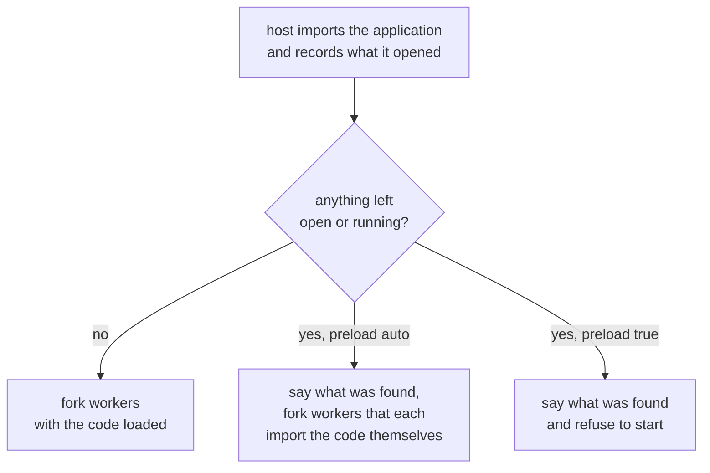

# Importing once, then forking

A server that imports your application once and then forks its
workers from that process gets two things for it. Each worker starts
with every module already loaded, so starting or replacing one costs a
fork rather than seconds of imports. And the workers share the
imported code and data with the process they were forked from, through
copy-on-write memory, until they write to it.

The catch is what a fork does not copy.

## What a fork copies

- **Memory is copied.** Modules, objects and caches are all there in
  the child.

- **Only the thread that called fork exists in the child.** A thread
  your code started at import, to send metrics, refresh a cache or
  reap a connection pool, is simply not running in any worker. Nothing
  fails: the work it did just never happens.

- **Sockets and pipes are shared, not copied.** A database connection
  opened at import is one connection, now used by every worker at
  once. Their requests and replies interleave on it, and a worker can
  read another's answer.

These bugs are intermittent, and they show up under load in
production rather than on the first request. Python 3.12 and later
warn when a process with more than one thread forks, but as a
`DeprecationWarning`, which Python shows only when the fork is in the
script you ran, never when it is in a server's own code.

## How servers handle it

**gunicorn with `--preload`** imports your application in the master,
then forks the workers. Its documentation says this saves memory and
speeds up boot. Nothing checks what the import left behind: a thread
or a connection opened at import is the trap above. gunicorn's
`post_fork(server, worker)` hook, in its configuration file, is where
you open them again in each worker, if you know you have to. Without
`--preload` each worker imports the application itself, which is safe
and loses the sharing.

**mod_wsgi in daemon mode** forks its daemon processes from Apache
before any of your code is loaded, and each daemon process imports
the WSGI script itself, on the first request or at startup. There is
no trap, and nothing is shared.

**uvicorn with `--workers`** starts each worker as a new Python
process (multiprocessing's spawn, not a fork), which imports your
application for itself. There is no trap, and nothing is shared.

**Muru** imports your application once, in the host, and forks the
workers from it, as gunicorn does with `--preload`. But it records
every socket, pipe, thread and child process the import leaves behind
before it forks:

| `--preload` | When the import check finds something |
| --- | --- |
| `auto`, the default | says what, and has each worker import the application itself, which is always safe |
| `true` | says what, and refuses to start, so a regression cannot slip through |
| `false` | never preloads and never checks |

The way to keep preloading is to do the work at the right time:
create the thing lazily on first use, or in a `post_fork` hook, which
runs in each worker right after the fork. Muru's hooks module can also
define `on_load`, `pre_fork`, `on_ready`, `on_drain`, `on_exit` and
`on_reopen_logs`.
