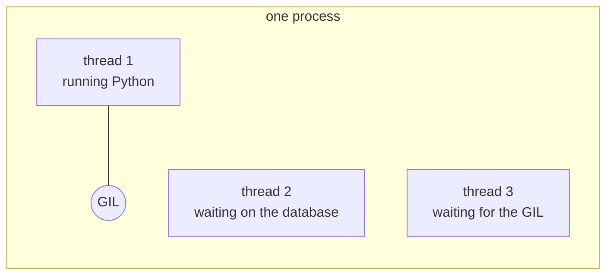
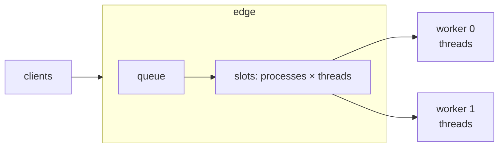

# Processes, threads and the GIL

Every server for Python web applications answers the same question:
how many requests can run your code at once, and in what. The answer
is some number of processes, each with some number of threads or an
event loop. What each buys depends on one thing about CPython.

## The GIL

On a regular CPython interpreter, only one thread in a process runs
Python code at a time. The global interpreter lock (GIL) is handed
from thread to thread, and a thread gives it up whenever it waits: on
a socket, a database driver, a file, a `sleep`.

So threads help a view that spends its time waiting, since a waiting
thread holds nothing. They do not help a view that spends its time
computing in Python, since only one of them can compute at a time.
Parallel computation on a regular interpreter needs processes, one per
CPU.

## How servers arrange it

| Server | Processes | Inside each process |
| --- | --- | --- |
| gunicorn, `sync` worker | `--workers` | one request at a time |
| gunicorn, `gthread` worker | `--workers` | `--threads` threads |
| mod_wsgi, daemon mode | `processes` of `WSGIDaemonProcess` (default 1) | `threads` (default 15) |
| uvicorn | `--workers` | one event loop, for ASGI |
| Granian, WSGI | `--workers` | `--blocking-threads` threads running Python, Rust threads for the network |
| Muru | `--processes` (default 1) | `--threads` (default 4) |

gunicorn's documentation suggests starting from `(2 × CPU cores) + 1`
workers, and Granian's from one worker per core.

The number that matters is processes times threads: how many requests
can be inside your code at once. When more arrive than that, the
others wait. Under most servers they wait unseen, in the listening
socket's queue or inside a worker, and nothing tells you how long.

## Where Muru's requests wait

Under Muru the edge keeps a slot for every thread of every worker, and
sends a request on only when a slot is free. A request that finds them
all busy waits in the edge's queue, outside Python, and the access log
records how long as `queue`. The time your code took is `app`. Read
together, they say which of two problems you have:

- **Time in `queue`**: every thread was busy. More threads help if
  your views wait; more processes help if they compute.

- **Time in `app` beyond what the view itself takes**: the request had
  a thread, and spent the time waiting inside Python, which for a view
  that computes is waiting for the GIL. More threads will not help;
  more processes, up to the number of CPUs, will.

Under the daemon, Muru also measures each worker group's CPU time and
GIL wait, and says which of these it is seeing.

## Free-threaded Python

Python 3.13 and later come in a second build, the free-threaded one
(`python3.14t`), which has no GIL: threads run Python in parallel, and
a single process with many threads can use every CPU. Muru's runtime
is built for these interpreters, and its wheels include them. On a
free-threaded build, the advice changes to a few processes with many
threads, for computing and waiting alike, as long as every extension
module you import supports it.
