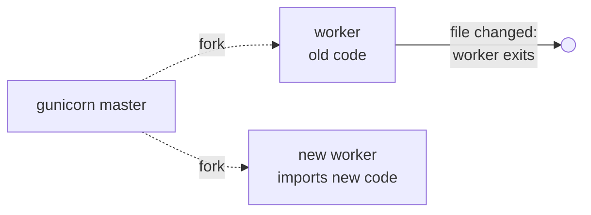
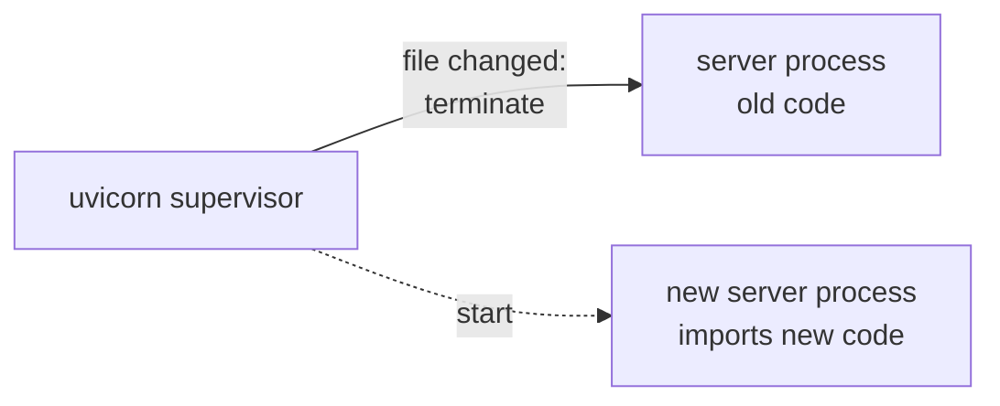
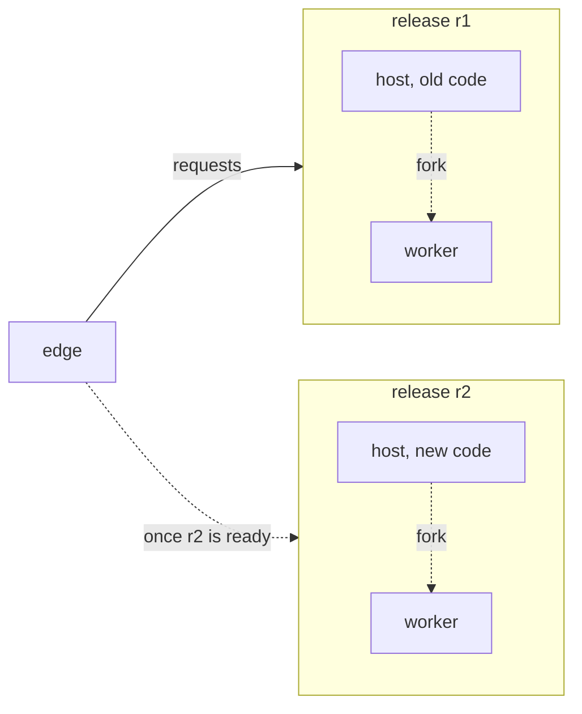

# What a reload replaces

Every development server can watch your files and serve the new code
when you save: gunicorn and uvicorn when asked with `--reload`, a
`muructl run` development run unless told not to. What differs is what
it replaces to do that, what happens to requests while it does, and
what you are left with when the new code does not even import.

## gunicorn

With `--reload`, each worker watches the files it imported. When one
changes, the worker exits, and the master forks a replacement, which
imports the code afresh. The reloader cannot be combined with
`--preload`, since a preloaded master would still hold the old code.

If the new code has a syntax error, the replacement worker logs it and
answers every request with a 500 holding the traceback, until you save
a version that imports.

## uvicorn

With `--reload`, a supervisor process watches the files and, on a
change, terminates the server process and starts a new one. If the new
code fails to import, the new process exits, and nothing serves
requests until the next change.

## muructl run

A development run reloads without a flag: `muructl` watches the files
and, on a change, starts a new release: a new host imports the new
code and forks new workers, while the old release goes on serving.
`--no-reload` turns it off for one run, and `reload = false` in the
project's run table or in `muru.local.toml` for good. Only once the new workers are
ready does the edge send requests to them. The old release then
finishes what it was serving and stops. The import check runs as
usual, so a reload is still a preload, and a request that arrives
during the reload is served by whichever release is serving, never
refused.

If the new code fails to import, the new host exits, the terminal says
so, and the old release keeps serving. Fix the file and save again,
and the next release replaces it.

| | What a change replaces | Requests during the reload | When the new code fails to import |
| --- | --- | --- | --- |
| gunicorn | each worker, in place | wait for a worker | every request is a 500 with the traceback |
| uvicorn | the server process | wait for the new process | nothing serves until the next change |
| muructl run | the release, beside the old one | served by the old release | the old release keeps serving |

The daemon deploys new code the same way, as a release that starts
beside the one serving, which is why a reload in development behaves
as a deploy in production does.
