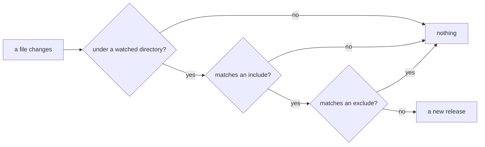

# Reload and HTTPS for a real project

The defaults of `--reload` and `--https` suit a project of Python
files served on `localhost`. A real project has templates and data
files, writes files of its own, and is reached under other names.

## What counts as a change

- gunicorn's `--reload` watches the Python modules the application
  imported, and `--reload-extra-file` adds files or glob patterns,
  such as templates.

- uvicorn's `--reload` watches `*.py` under the current directory;
  `--reload-dir` changes the directories, and `--reload-include` and
  `--reload-exclude` the patterns, which need the `watchfiles` package.

- `muructl run --reload` watches `**/*.py` under the project's
  directory. `--reload-dir` names other directories to watch,
  `--reload-include` the files that count as source and
  `--reload-exclude` files that never do, each repeatable, with paths
  relative to the watched directory.

`--reload-include` adds to the default rather than replacing it, so a
project that adds `**/*.html` still reloads on a changed module. An
include pattern wide enough to catch a file the application itself
writes, such as a cache or a record of the last visit, makes every
request that writes it start a new release, which is what
`--reload-exclude` is for. An exclude wins over an include, so
`--reload-exclude '**/*.py'` watches the included patterns alone. The
startup line `muru: watching ...` names the directories and patterns
watched.

## A request in flight

Under `muructl run`, a reload starts a new release beside the old one
and switches to it once it is ready. A request the old release had
already started finishes there, with the old code, and only new
requests reach the new one. gunicorn's reload replaces its workers
and uvicorn's the whole server process, and requests that arrive
meanwhile wait for one to be ready.

## HTTPS in development

`--https` serves HTTPS beside HTTP, on `--https-port`. With
[mkcert](https://mkcert.dev) installed and its CA trusted, Muru asks
it for a certificate that browsers trust; without it, Muru makes a
self-signed one. Either way the certificate is kept in Muru's cache
directory and reused while its names stay the same.

- `--host NAME` adds a name to the development certificate beside
  `localhost`, `127.0.0.1` and `::1`, for a project reached as
  `menu.test` through a hosts file entry or a tunnel. A new name makes
  a new certificate.

- `--https-only` answers plain HTTP with a redirect to the same path
  over HTTPS, to test what a site does behind a redirect from `http:`.

- `--tls-cert` and `--tls-key` serve a certificate of your own instead,
  such as one from your organisation's CA, or from a tool that makes a
  local CA for tests, as `trustme` does. A relative path is read from
  the project's directory.

gunicorn takes `--certfile` and `--keyfile` and uvicorn
`--ssl-certfile` and `--ssl-keyfile`, both for a certificate you make
yourself; neither makes one, and neither redirects HTTP to HTTPS.
