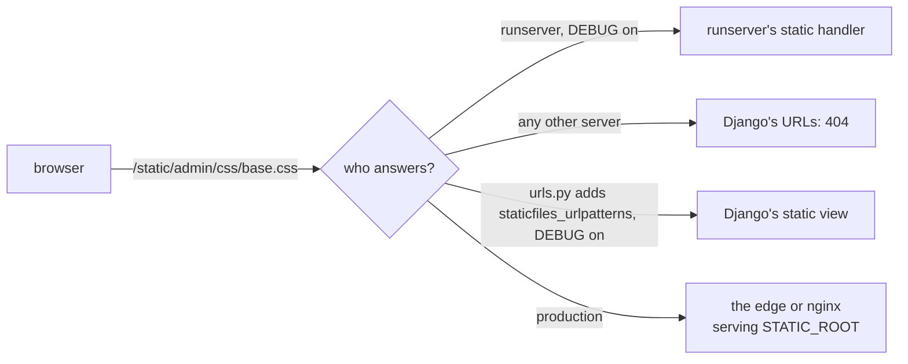

# A Django project and its server

`django-admin startproject` writes two entrypoints into every project:
`wsgi.py`, which defines `application` with `get_wsgi_application()`,
and `asgi.py`, which does the same with `get_asgi_application()`. Both
set `DJANGO_SETTINGS_MODULE` with `os.environ.setdefault`, so a server
pointed at either needs to be told nothing else about the project.

## Who serves it

- `manage.py runserver` is Django's own development server. It
  reloads on changes, and with `DEBUG = True` it also serves every
  installed app's static files, through a handler of its own wrapped
  around the application.

- gunicorn serves `mysite.wsgi`, uvicorn and Granian serve
  `mysite.asgi:application`, and mod_wsgi loads `wsgi.py` as the script
  of a `WSGIScriptAlias`.

- `muructl run` serves `mysite.wsgi:application` or
  `mysite.asgi:application`, named on the command line or in the
  project's `[tool.muru]` table.

None of the servers is `runserver`, so none of them has its static
files handler.

## Importing once

Importing `wsgi.py` calls `get_wsgi_application()`, which runs
`django.setup()`: the settings are read and the installed apps and
their models are imported. Django connects to the database only when
a query runs, so the import leaves nothing open, and Muru's host can
import the project once and fork the workers from it. A project whose
settings or an app's `ready()` connects to a database server at import
leaves a socket open, which Muru's import check looks for before the
fork.

## Static files

Under any server but `runserver`, a request for a static file reaches
Django's URL configuration, which has no route for it, and the answer
is 404: the admin's pages arrive with no styles. Two ways to have them
in development:

- `staticfiles_urlpatterns()` from `django.contrib.staticfiles.urls`,
  added to the project's `urlpatterns`, serves every app's static
  files through a Django view while `DEBUG` is on, and adds nothing
  when it is off.

- WhiteNoise, a middleware that serves them in development and
  production alike.

In production, `manage.py collectstatic` copies every app's files into
`STATIC_ROOT`, and something in front serves that directory. Under
Muru's daemon that is a static route at the edge.

## When a view raises

Django answers an unhandled exception itself: with its debug page,
which shows the traceback with each frame's local variables, the
request and the settings, when `DEBUG = True`, and with its
`handler500` view otherwise. Either way the server sees an ordinary
500 response.

With `DEBUG_PROPAGATE_EXCEPTIONS = True`, the exception reaches the
server instead. Under Muru the edge answers with its own error page,
with the traceback while you develop, and the access log line says
`reason=app_error`, as it does for every project Muru serves. Which to
prefer in development is a choice: Django's page shows more about the
request, Muru's records the failure the same way for any framework.

## Over ASGI

`get_asgi_application()` serves HTTP and has no lifespan support,
which Muru allows. Under ASGI, Django runs an `async def` view on the
worker's event loop, and hands a plain `def` view to a thread of its
own with `sync_to_async`, so the loop is never blocked by it. Under
WSGI it is the other way round: each request has a thread, and Django
runs an `async def` view in an event loop it starts for that view.
