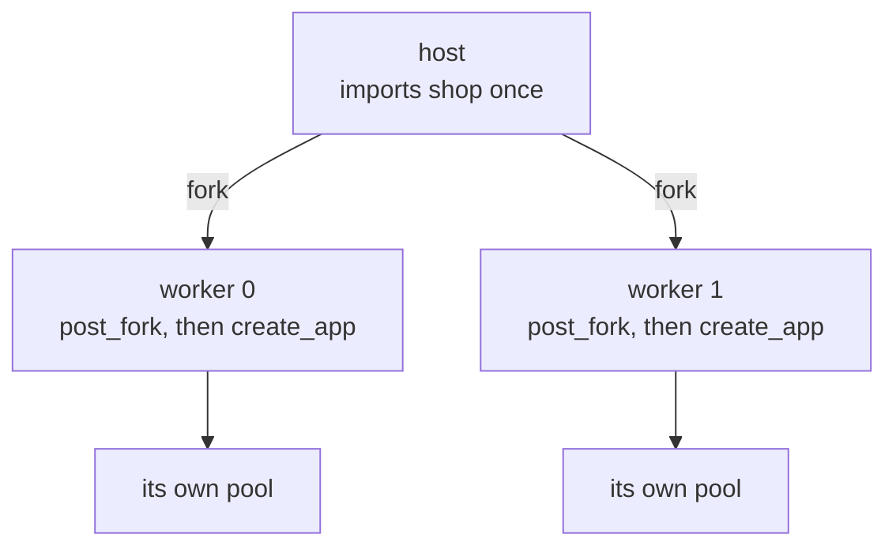

# A Flask project and its server

Flask is a WSGI framework, so any WSGI server can serve it. What a
project has to tell the server differs from one server to the next in
three places: how the application is built, how its logging is set
up, and who answers when a view raises.

## Building the application

A small Flask project creates `app = Flask(__name__)` at module level,
and a server is pointed at `module:app`. A larger one uses the
application factory pattern: a function, by convention `create_app()`,
builds the application, reads its configuration and opens what it
needs, such as a database pool. A server has to be told to call it.

- `flask run` imports the project and calls the factory itself, in the
  one process of Werkzeug's development server.

- gunicorn takes `'shop:create_app()'` and calls it when it loads the
  application: in each worker, or once in the arbiter before the
  workers are forked when `--preload` is given.

- mod_wsgi loads a WSGI script file that must define `application`, so
  the file calls the factory itself, `application = create_app()`, in
  each daemon process.

- `muructl run` takes `shop:create_app` with `--factory`, or `factory
  = true` in the project's `[tool.muru]` table. The host imports the
  module once, forks the workers, and each worker calls the factory
  after its `post_fork` hook.



What the factory opens belongs to the worker that called it, which is
what makes a factory the safe place to open a database pool. With
`factory_phase = "host"` in the table, Muru calls the factory once in
the host instead, before the fork, as gunicorn's `--preload` does.
That shares one build between the workers, which is only safe when the
factory opens nothing a process cannot share.

Without `--factory`, Muru takes `create_app` for the application
itself, as any WSGI server would, and calls it with each request's
environment.

## Logging

Flask's `app.logger` has no level of its own, so it logs at the level
of the root logger. Before the project is imported, Muru sets the root
logger's level, `WARNING` unless the project says otherwise, which is
Python's own default. A project asks for more in its table:

```toml
[tool.muru.logging.python]
level = "INFO"
```

Each record a worker writes arrives in the terminal tagged with that
worker, `muru.worker[0]:`, in Flask's own format.

## When a view raises

Flask catches an exception a view raises, logs it, and answers with
its own plain 500 page, so the server sees an ordinary response. With
Flask's `PROPAGATE_EXCEPTIONS` setting on, the exception reaches the
server instead. Under Muru the edge then answers with its own error
page, the traceback in it while you develop, and the access log line
says `reason=app_error`.

A factory that calls `app.config.from_prefixed_env()` takes any Flask
setting from an environment variable named `FLASK_` and the setting,
so `FLASK_PROPAGATE_EXCEPTIONS` in the table's `env` turns it on for
every worker.
