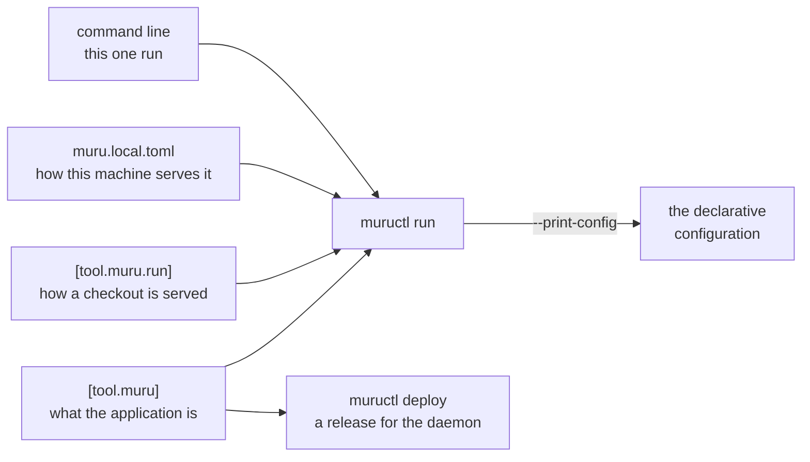

# Where a server's settings live

A project that is served the same way by everyone who works on it needs
its server settings written down somewhere other than a shell's
history. Each server has its own answer.

## gunicorn

gunicorn reads its settings from five places, each overriding the one
before:

1. environment variables, for the settings that have them;

2. Paste Deploy's configuration, for Paste applications;

3. a Python file, `gunicorn.conf.py` in the working directory by
   default, which is run on every start;

4. the `GUNICORN_CMD_ARGS` environment variable;

5. the command line.

`gunicorn --print-config` prints the settings these add up to.

## uvicorn and Granian

Neither has a file for its own settings. Each takes them from the
command line, from environment variables (`UVICORN_` and `GRANIAN_`
followed by the option's name), or, for uvicorn, from the arguments
to `uvicorn.run()` in a script of your own. A project that wants its
settings kept with it writes a script or a `Makefile` target.

## Apache and mod_wsgi

The settings are Apache directives, such as `WSGIDaemonProcess` with
its `processes` and `threads`, in the Apache configuration, which
belongs to the machine rather than to the project. `mod_wsgi-express`
takes them on its command line instead.

## Muru

A project carries its settings in its `pyproject.toml`, in two tables,
or with the same keys in a `muru.toml` (`[tool.muru]` becoming the top
level and `[tool.muru.run]` a `[run]` table). `muructl run` reads them
from the project directory, so a project run with no arguments is
served the way they say.

`[tool.muru]` holds what the application is, wherever it runs: its
entrypoint, its worker processes and threads, its hooks module, its
timeouts, its environment variables, its mounts and worker groups.

`[tool.muru.run]` holds how a checkout of the project is served while
someone works on it: the port, HTTPS and its certificate, extra host
names, whether the run reloads and what counts as a change, the access
log, the dashboard and compression. Each is a flag of `muructl run`,
named in snake case; `--reload-include '**/*.html'` is `reload_include
= ["**/*.html"]`. The daemon ignores this table: `muructl deploy` takes
the application and nothing of how a laptop served it.

`muru.local.toml`, beside `pyproject.toml`, holds a `[run]` table with
the same keys for one machine alone: the port that is free on this
laptop, the dashboard turned off. It is never committed, and the run
warns while the project's `.gitignore` does not name it.

A flag wins over the local file, the local file over the project's
table, and the table over the defaults; lists such as `hosts` and the
reload patterns add across the layers, and a boolean a file turns on
has a flag to turn it off for one run (`--no-reload`, `--no-https`).
Every key is checked, and a key a table does not know stops the run
with a list of the keys it does. `--bind` and `--allow-public`, which
serve beyond loopback, have no key and are typed each time.

The application's table is not only for development. The daemon reads
`[tool.muru]` when a project directory is deployed to it, so the
settings that describe the application on your laptop go with it into
its releases. `muructl run --print-config` writes what a run amounts to
as the daemon's declarative configuration, the listeners the run
resolved and the release from `[tool.muru]`, a step towards running
the project as a service.
