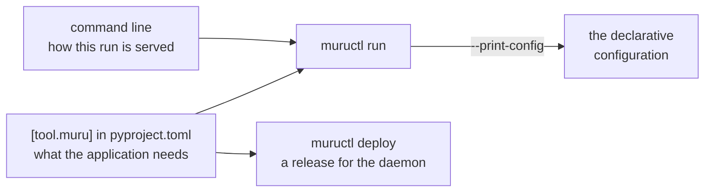

# Where a server's settings live

A project that is served the same way by everyone who works on it needs
its server settings written down somewhere other than a shell's
history. Each server has its own answer.

## gunicorn

gunicorn reads its settings from five places, each overriding the one
before:

1. environment variables, for the settings that have them;

2. Paste Deploy's configuration, for Paste applications;

3. a Python file, `gunicorn.conf.py` in the working directory by
   default, which is run on every start;

4. the `GUNICORN_CMD_ARGS` environment variable;

5. the command line.

`gunicorn --print-config` prints the settings these add up to.

## uvicorn and Granian

Neither has a file for its own settings. Each takes them from the
command line, from environment variables (`UVICORN_` and `GRANIAN_`
followed by the option's name), or, for uvicorn, from the arguments
to `uvicorn.run()` in a script of your own. A project that wants its
settings kept with it writes a script or a `Makefile` target.

## Apache and mod_wsgi

The settings are Apache directives, such as `WSGIDaemonProcess` with
its `processes` and `threads`, in the Apache configuration, which
belongs to the machine rather than to the project. `mod_wsgi-express`
takes them on its command line instead.

## Muru

A project carries its settings in a `[tool.muru]` table in its
`pyproject.toml`, or with the same keys at the top level of a
`muru.toml`. `muructl run` reads the table from the project directory,
so a project run with no arguments is served the way the table says.

The table holds what the application needs wherever it runs: its
entrypoint, its worker processes and threads, its hooks module, its
timeouts, its environment variables, its mounts and worker groups.
Each key is checked, and a key the table does not know stops the run
with a list of the keys it does.

How one particular run is served stays on the command line: the port
and address, `--reload`, HTTPS, the access log and the dashboard. A
flag given for a setting the table also has wins for that run.

The table is not only for development. The daemon reads the same table
when a project directory is deployed to it, so the settings that
served the project on your laptop go with it into its releases.
`muructl run --print-config` writes what a run amounts to as the
daemon's declarative configuration, a step towards running the project
as a service.
