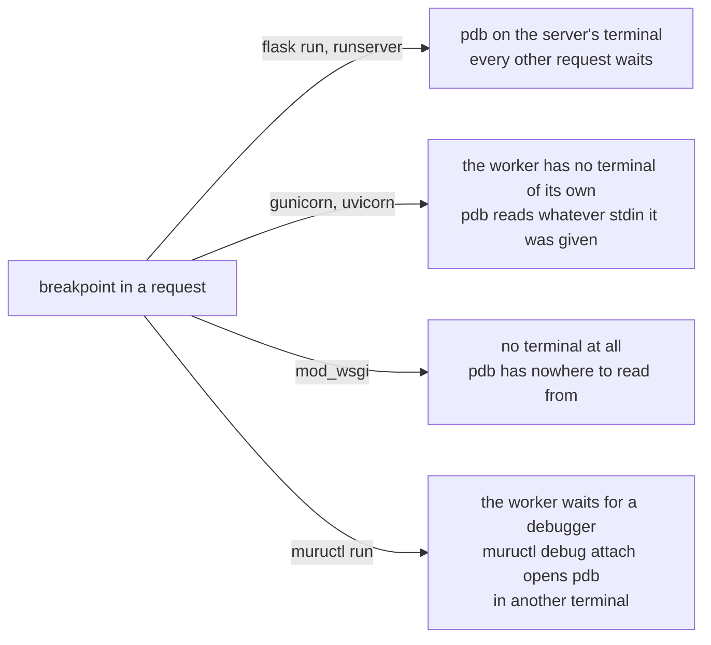

# A breakpoint in a request

`breakpoint()` is Python's way to stop and look: outside any server it
opens pdb on the terminal. What happens to it inside a request depends
on who owns the terminal, and on what the server does with a worker
that has stopped answering.

- `flask run` and `manage.py runserver` are one process on your
  terminal, so `breakpoint()` puts the pdb prompt there, and every
  other request waits until you type `continue`. That is why they are
  the servers people debug under, and why they are not the servers
  people deploy.

- gunicorn and uvicorn fork workers, which have no terminal of their
  own. pdb reads from the standard input the worker inherited: the
  terminal the server was started from when it was started in the
  foreground, with several workers able to fight for it, and nothing
  usable otherwise.

- mod_wsgi runs the application inside Apache, which has no terminal,
  so pdb has nowhere to read commands from and the request fails.

- `muructl run` forks workers too, but the runtime gives `breakpoint()`
  another meaning in them: the worker stops the request where it is
  and waits for a debugger, for 60 seconds or the `timeout` the call
  gives, and the terminal says which worker and which line, and the
  command to attach. The request is exempt from the soft and hard
  timeouts while it waits. `muructl debug attach` opens a pdb session
  on it from any other terminal, through the run's admin socket. The
  session ends with `continue` or the end of input, and the request
  goes on. When nobody attaches, the wait expires and the request goes
  on as if the call were not there.

Outside Muru, `breakpoint()` is the ordinary pdb, so a call can stay
in the code while you develop; `PYTHONBREAKPOINT` keeps whatever it
names.

## While a session is open

The worker takes no new requests, and nothing replaces it: recycling,
the hard timeout, memory limits and scaling wait until the session
ends. `muructl debug status` shows it as `debugging`. Each session is
the event `debug.attached`, and `debug.detached` when it ends.

## With no breakpoint waiting

`muructl debug attach` on a worker with no breakpoint waiting opens the
session on a thread of its own, from which the worker's modules and
state can be read and changed. Each worker is a process with state of
its own, so what a session changes is changed in that worker alone,
which `muructl debug exec` shows by running the same expression in
every worker.
