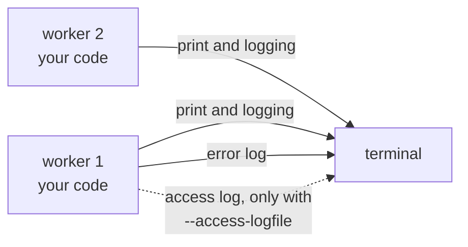
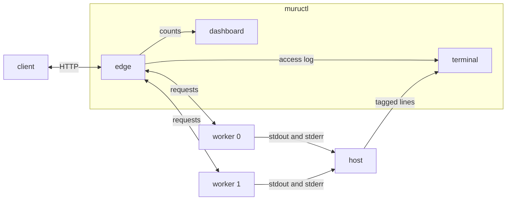

# Where a development server's output goes

While you develop, a server tells you three things: what requests it
served, what your code printed or logged, and what went wrong when a
request failed. Where each of those goes, and how much it says, is
different from one server to the next.

## gunicorn

- **Requests.** No access log unless you ask for one with
  `--access-logfile -`. Its default format is the Apache combined log:
  client, time, request line, status, size, referrer and user agent,
  with no timing unless you add it to `--access-logformat`.

- **Your output.** The workers share the terminal they were started
  from, so what your code prints arrives as it is, with nothing to say
  which worker printed it.

- **Failures.** An exception in your code is written to the error log,
  which is the terminal by default, as `Error handling request` with
  the traceback. The client gets a short `Internal Server Error` page.

## uvicorn

- **Requests.** An access log is on by default, one line per request
  such as `INFO: 127.0.0.1:52341 - "GET / HTTP/1.1" 200 OK`, with no
  timing.

- **Your output.** As for gunicorn, workers write straight to the
  terminal.

- **Failures.** An exception is logged as `Exception in ASGI
  application` with the traceback, and the client gets a plain text
  `Internal Server Error`.

Neither server shows the traceback to the client, which is right in
production and slows you down in development, where the browser is
where you are looking. Neither has a dashboard.

## muructl run

- **Requests.** The edge writes an access log line for every request,
  with the time the request waited for a worker thread (`queue`), the
  time your code took (`app`), the worker that served it and a request
  id. `--access-log errors` keeps only failures and slow requests, and
  `--access-log` with a file name writes JSON lines instead.

- **Your output.** The host relays each worker's standard output and
  standard error to the terminal, tagged with the worker's index:
  `muru.worker[0].stdout:` for what it prints, `muru.worker[0]:` for
  standard error, where Python's `logging` goes. You can tell which
  worker said what.

- **Failures.** When your code raises, the edge answers with an error
  page of its own, which in development shows the traceback. It is
  HTML for a browser and an `application/problem+json` document for a
  client that asks for JSON, and the access log line says
  `reason=app_error`. The same request id is in the page, the log line
  and the `X-Request-ID` header.

- **The dashboard.** A page on a second port shows the workers,
  requests per second, latency, the recent requests and the recent
  output, from the counts the edge keeps.

| | Access log by default | Timing in it | Output tagged by worker | Traceback for the client | Dashboard |
| --- | --- | --- | --- | --- | --- |
| gunicorn | no | only if you add it | no | no | no |
| uvicorn | yes | no | no | no | no |
| muructl run | yes | queue and app time | yes | in development | yes |
