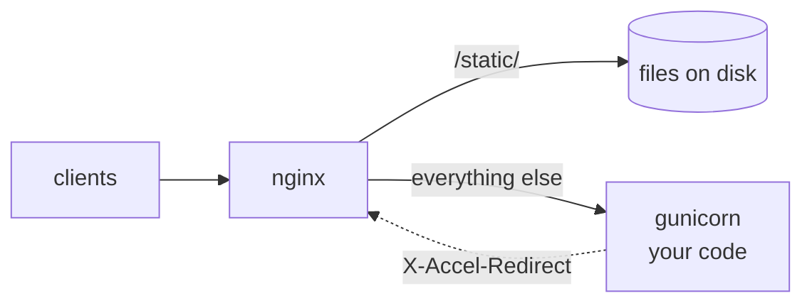

# What nginx was for

gunicorn's documentation says to run it behind a proxy, and most
deployments of gunicorn, uvicorn and Granian have nginx in front, as
Apache is in front of mod_wsgi. Some of what the proxy does is about
connections: TLS, HTTP/2, buffering slow clients so they do not hold a
worker. The rest is about responses, and is configured in the proxy
because the application server cannot do it:



A typical nginx configuration for a shop like the one in this
workshop:

```nginx
server {
    listen 80;

    # Static files, from disk, with a cache lifetime, and the .gz
    # file beside each one sent to clients that accept gzip.
    location /static/ {
        alias /srv/shop/static/;
        expires 1h;
        gzip_static on;
    }

    # Files the application decides a client may have, sent by nginx
    # when the application answers with X-Accel-Redirect.
    location /protected/ {
        internal;
        alias /srv/shop/reports/;
    }

    # The application, with its responses compressed, its 404s
    # replaced by a page of the site's own, and a maintenance page
    # while a flag file exists.
    location / {
        if (-f /srv/shop/maintenance) { return 503; }
        proxy_pass http://127.0.0.1:8000;
        gzip on;
        gzip_types application/json;
        proxy_intercept_errors on;
        error_page 404 /errors/404.html;
        error_page 503 /errors/maintenance.html;
    }
}
```

That is a second piece of software to install, configure, run and keep
in step with the application, with its own idea of paths, and a
configuration language of its own.

## The edge does it

Muru's edge is already between the clients and the workers, so it does
these things itself. The same shop under the Muru daemon is one
configuration file, `site.toml`:

| | nginx | Muru |
| --- | --- | --- |
| Static files with cache headers | `location` with `alias` and `expires` | a `[[route]]` with `static` and `cache` |
| Precompressed files | `gzip_static on` | always: a `.br`, `.zst` or `.gz` file beside the file |
| Compressing responses | `gzip on` and `gzip_types` | always, for text and JSON; `[compression]` to tune it |
| A file the application chooses | `X-Accel-Redirect` to an `internal` location | `X-Muru-Sendfile` within the release's `sendfile_roots` |
| The site's own error pages | `proxy_intercept_errors` and `error_page` | `error_pages`, and `error_override` for the application's own errors |
| Maintenance page | a flag file and `return 503` | `muructl maintenance on` |

Static files and a file the application chooses are sent by the edge,
in Rust, with `ETag`, `Last-Modified`, conditional requests answered
`304` and ranges answered `206`. Python never sees a static request,
and the worker thread that named a file is free while the file is
sent. The error pages and maintenance mode are answered by the edge,
without troubling the workers.

The edge also terminates TLS on a listener and speaks HTTP/2 to
clients. Muru's guide to running behind a proxy covers the case where
a load balancer stays in front anyway.
