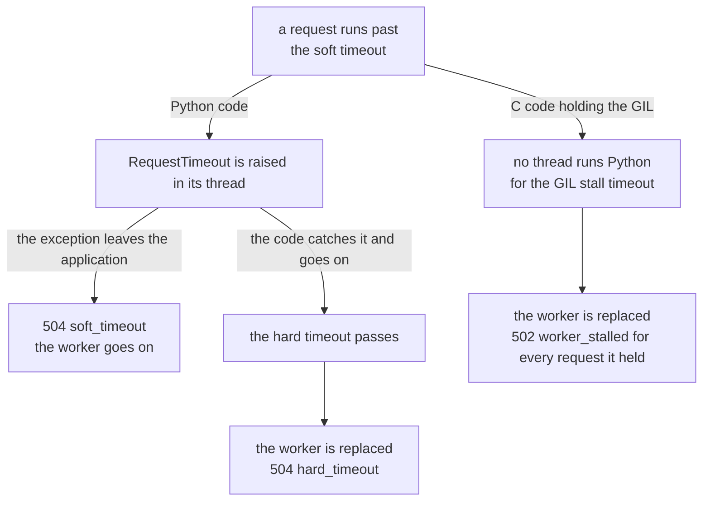

# When a request hangs

A request that never finishes holds a thread, or a whole worker, for
as long as it runs, and its client waits. How a server finds it and
what it does about it decide whether one bad request costs one
response or many.

## The servers

- gunicorn's `--timeout`, thirty seconds by default, kills a worker
  that has not reported to the arbiter for that long. A synchronous
  worker stuck in one request stops reporting, so it is killed with
  that request. A threaded worker reports from another thread, so one
  thread stuck in a request goes unnoticed.

- uvicorn has no limit on how long a request may run.

- mod_wsgi's `request-timeout` option of `WSGIDaemonProcess` restarts
  the daemon process once its requests have run for that long.

## Muru's timeouts in the worker

| Name | Default | Measured | What happens |
| --- | --- | --- | --- |
| `soft` | off | from the request reaching the worker | `muru.RequestTimeout` is raised in the request's thread, the edge answers `504` with `reason=soft_timeout`, and the log says where the request was |
| `hard` | off | from the request reaching the worker | the worker is replaced and the request answered `504` with `reason=hard_timeout`; the worker's other requests get the hard drain grace to finish |
| `gil_stall` | 30s | since any thread of the worker last ran Python | the worker is replaced, and every request it held is answered `502` with `reason=worker_stalled` |

Each is set with `--timeout NAME=DURATION`, or in the project's
`[tool.muru.timeouts]` table, where the hard timeout must exceed the
soft one by at least five seconds.

The soft timeout is raised inside the request's thread, which happens
only when that thread next runs Python. Python code that loops or
waits gives way to it. A call into C that holds the GIL, such as a
regular expression that backtracks or a C extension that never
returns, does not: no Python runs in the thread until the call
returns, and while it holds the GIL, none runs in any other thread of
the worker either.

`muru.RequestTimeout` is a `BaseException`, so a handler that catches
`Exception` lets it through. A bare `except:`, or one that catches
`BaseException`, swallows it, and the code goes on running. That is
what the hard timeout is for: the host sees from the worker's reports
that a request has run too long, and replaces the worker without
needing anything from the stuck code.

The GIL stall timeout is for a worker in which nothing runs Python at
all, with or without a request in flight. A thread outside Python
notices that it has not been able to take the GIL for the timeout's
length, which is thirty seconds unless set otherwise; it is on by
default.

A worker either of them replaces leaves routing at once, keeps what it
holds for the hard drain grace (ten seconds) and the shutdown timeout
(five), and is killed, with each thread's stack written to the log by
`faulthandler`.

## Finding where it was

Every timeout says where the request or the worker was: the soft
timeout's line names the file, line and function, and a replaced
worker's stacks show every thread. That points at the code to change,
which is the only real fix: a narrower `except`, or a pattern without
a nested `+`.

## The access log

A project that hangs now and then wants the access log to show what
needs attention. `--access-log errors` keeps only `4xx` and `5xx`
responses and requests slower than `--slow`, one second by default,
and `--access-log-exclude PATTERN` hides requests whose path matches,
such as a load balancer's health checks.
