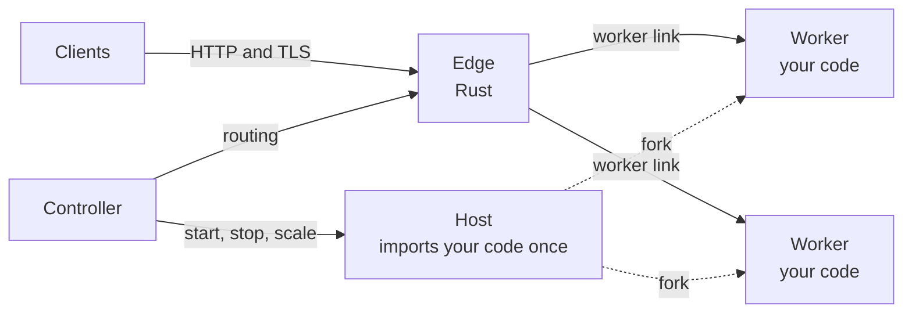
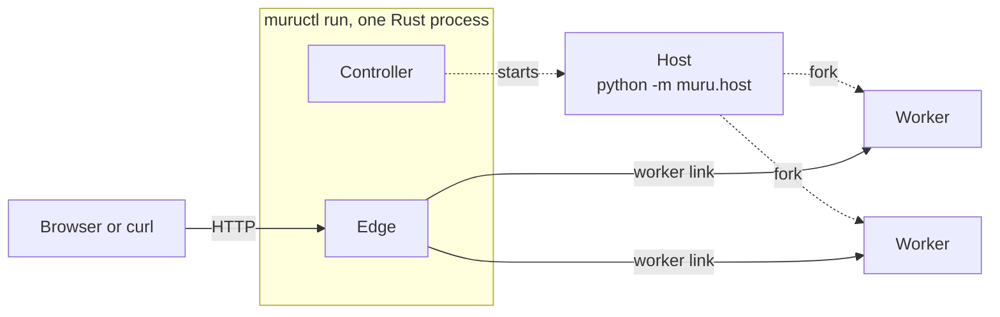

# How Muru serves an application

Muru gives the work of serving an application to three kinds of
process, each with one job.

- **The edge** accepts client connections. It terminates TLS, speaks
  HTTP/1.1 and HTTP/2, decides where each request goes, queues it when
  every worker is busy, and writes the access log. It is written in
  Rust and never runs Python.

- **The host** is a Python process that imports your application once
  and forks the workers from itself, so each worker starts with your
  code already loaded. When a worker dies, the host forks a
  replacement.

- **Workers** run your code: WSGI applications on a pool of threads,
  ASGI applications on an event loop. A worker never talks to a client.
  It gets each request from the edge over a private link, already
  parsed, and sends the response back the same way.

- **The controller** decides what should be running and keeps it
  running. It is never on the path a request takes.

## In development: muructl run

`muructl run` is the development mode. The edge and the controller run
inside the one `muructl` process, which starts a host for your
application, and the host forks the workers. It serves on the loopback
address only, and error pages show the traceback.

## The same comparison, with Muru

| Arrangement | Talks to clients | Runs your code | Same process? | New code |
| --- | --- | --- | --- | --- |
| Apache with mod_wsgi, daemon mode | Apache child | mod_wsgi daemon process | No | Restart the daemon processes |
| nginx and gunicorn | nginx, then the gunicorn worker | gunicorn worker | Yes, in the worker | HUP, or a restart when preloaded |
| uvicorn | uvicorn worker | uvicorn worker | Yes | Restart the workers |
| Granian | Granian worker, in Rust | Granian worker, in Python | Yes | Restart the workers |
| Muru | The edge, in Rust | A worker, forked from the host | No | A new release starts beside the old one |

The closest of the four is mod_wsgi's daemon mode: a front end that
reads the request and a separate process that runs your code. What
Muru adds is in the last column, and the last document of this
workshop shows it.
