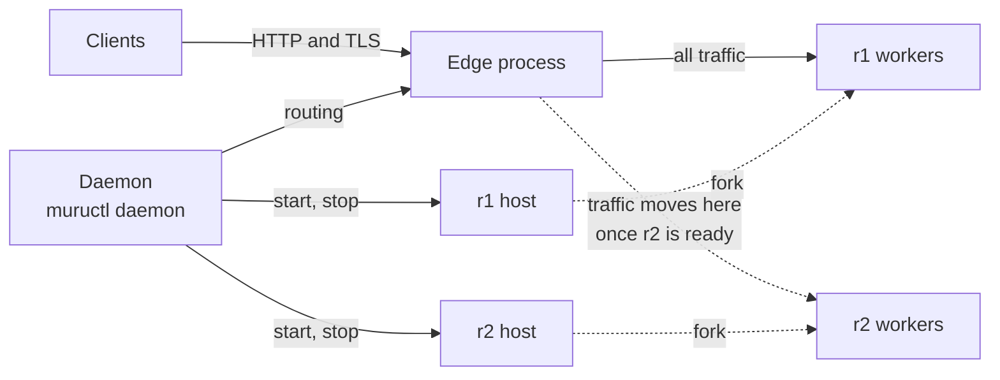

# From development to the daemon

`muructl run` serves one copy of your code, the one in the directory
it was started in. For an application that stays up, Muru runs a
daemon, and the unit it deploys is a **release**: your code, the
Python it runs on and its settings, fixed when the release is made.

Under the daemon the edge is a process of its own, and the daemon is
another, so neither a deploy nor a restart of the daemon interrupts
the edge. Each release has its own host and workers. Deploying `r2`
starts it beside `r1`, which keeps serving. When every worker of `r2`
is ready, the edge sends new requests to it, and `r1` finishes the
requests it has before it is drained. `r1` stays warm for a while
afterwards, so moving back to it is a change of routing, not a
restart.

Because the edge can route to more than one release at once, the same
mechanism gives the rest:

- **Blue/green**: move all traffic to the new release once it is
  ready.

- **Canary**: give the new release a growing share of the requests,
  with gates on its error rate and latency, rolling back if a gate
  fails.

- **Preview**: send only the requests that ask for it, by a header or
  a cookie, to a release that has no share of the traffic.

- **Rollback**: send traffic back to the release that served before.

None of this needs a second deployment or a load balancer outside the
server, and a release can even run a different version of Python from
the one before it.

`muructl run --print-config` writes the settings of a development run
as the configuration the daemon reads, which is the path from one to
the other. The workshops after this one cover the daemon, releases and
traffic in turn.
