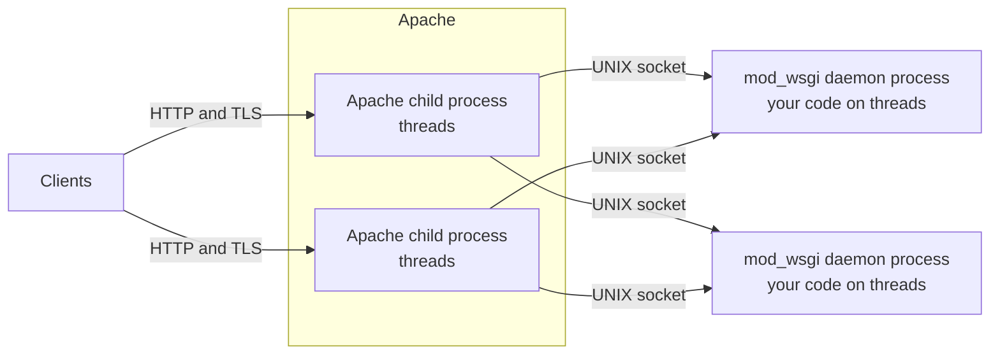
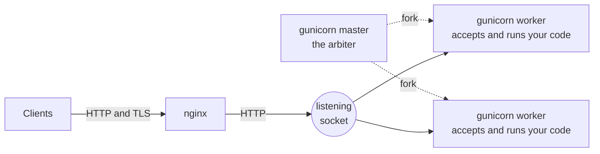
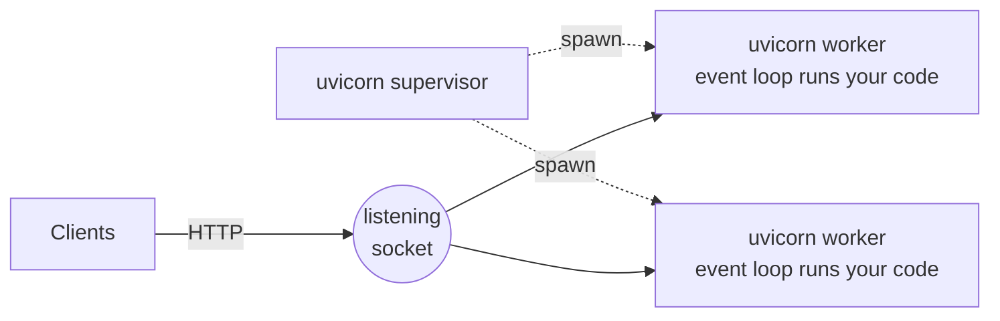
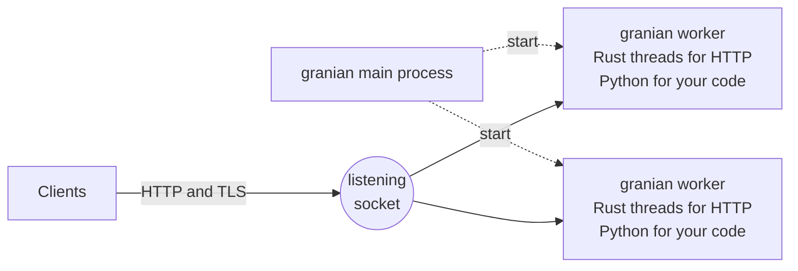

# How Python web applications are usually served

A Python web application is written to a contract, WSGI for
synchronous code or ASGI for asynchronous code, and a server is what
turns HTTP requests into calls on it. Which server you choose decides
which process talks to clients, which process runs your code, how many
of each there are, and what has to happen before new code is served.

These are four common arrangements. Read each with those questions in
mind.

## Apache with mod_wsgi

Apache accepts the connections and handles TLS, HTTP/2, static files
and virtual hosts. mod_wsgi runs your code in one of two places:

- **Embedded mode** runs it inside the Apache child processes, so the
  Apache MPM decides how many processes and threads there are, and
  they are shared with everything else Apache serves.

- **Daemon mode**, the one to use, runs it in separate daemon
  processes with a fixed number of threads each. An Apache child reads
  the request and passes it to a daemon process over a UNIX socket, as
  drawn above. `mod_wsgi-express` sets this up from the command line.

New code means restarting the daemon processes, for example by
touching the WSGI script file. The replacements import your code
again, and requests wait for them.

## nginx in front of gunicorn

gunicorn's master process forks the workers and replaces any that die.
Each worker accepts connections on the shared listening socket itself,
parses the HTTP and calls your code. The worker class decides how many
requests a worker takes at once: `sync` takes one, `gthread` runs a
pool of threads, and ASGI applications run under the worker class that
uvicorn provides. With `--preload` the master imports your code once
before forking, so the workers start with it loaded.

gunicorn's documentation recommends a proxy such as nginx in front,
which handles TLS, HTTP/2 and static files, and buffers slow clients
so they do not tie up a worker.

New code means a HUP signal, on which the master starts new workers
and gracefully stops the old ones. If the code was preloaded, the
master still holds the old version, so it takes a full restart
instead.

## uvicorn

uvicorn is an ASGI server. One process runs an asyncio event loop that
reads requests and runs your application's coroutines, with
synchronous code sent to a thread pool. With `--workers` a supervisor
process starts several worker processes, each importing your code for
itself rather than forking a loaded copy. It speaks HTTP/1.1 and
WebSockets, and is often run behind a proxy, or under gunicorn with
uvicorn's worker class so gunicorn manages the processes.

New code means restarting the worker processes. `--reload` does that
on every change, for development.

## Granian

Granian is an HTTP server written in Rust that runs Python
applications through ASGI, WSGI or its own RSGI interface. It speaks
HTTP/1.1 and HTTP/2 and can terminate TLS itself. Each worker process
holds Rust threads that do the network I/O and parse HTTP, and the
Python interpreter that runs your code, with WSGI calls on a pool of
blocking threads.

New code means restarting the worker processes. `--reload` does that
on every change, for development.

## What they have in common

| Arrangement | Talks to clients | Runs your code | Same process? | New code |
| --- | --- | --- | --- | --- |
| Apache with mod_wsgi, daemon mode | Apache child | mod_wsgi daemon process | No | Restart the daemon processes |
| nginx and gunicorn | nginx, then the gunicorn worker | gunicorn worker | Yes, in the worker | HUP, or a restart when preloaded |
| uvicorn | uvicorn worker | uvicorn worker | Yes | Restart the workers |
| Granian | Granian worker, in Rust | Granian worker, in Python | Yes | Restart the workers |

Each serves one version of your code at a time. Shipping a new version
means replacing the processes that run the old one. Running two
versions side by side, to try the new one on a share of the traffic
first or to move back in an instant, is something you build around the
server: a second deployment, and a load balancer that splits the
traffic between them.

Muru starts from a different split of the work, which the next
document describes.
