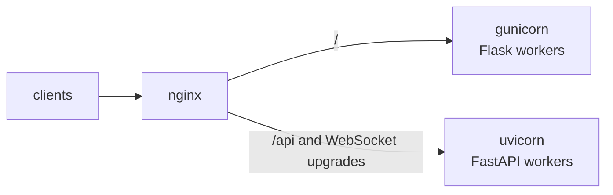
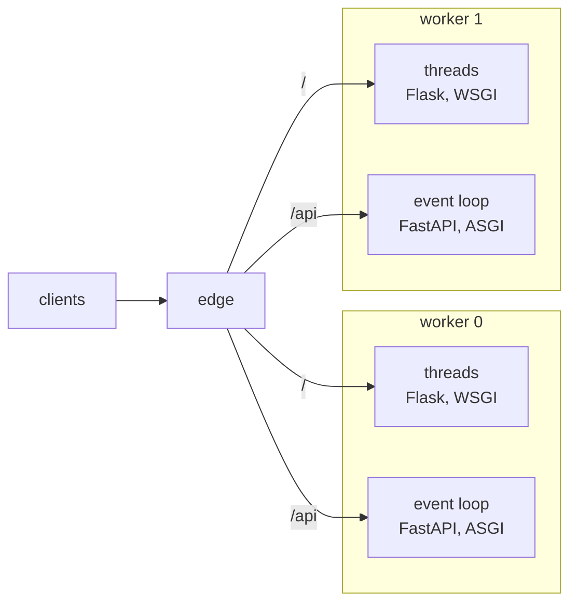

# WSGI and ASGI in one site

Many sites end up with both kinds of Python application: a WSGI one,
in Flask or Django, for the pages, and an ASGI one, in FastAPI or
Starlette, for an API or WebSockets. Each server takes one of them.

## How servers handle it

- **gunicorn** serves WSGI. It serves ASGI through the worker class
  uvicorn provides (`-k uvicorn.workers.UvicornWorker`), but a gunicorn
  serves one application with one worker class.

- **uvicorn** serves ASGI. Its `--interface wsgi` wraps a single WSGI
  application instead, not both.

- **Granian** takes `--interface asgi`, `rsgi` or `wsgi`: one interface,
  and one application, per server.

- **mod_wsgi** serves WSGI only.

So the usual answer is two servers, one for each application, with a
proxy in front that sends `/api` and the WebSocket upgrades to one and
everything else to the other:

That is two process trees to size, two sets of logs, two deploys to
keep in step, and a proxy configuration that has to know about
WebSocket upgrades.

## Mounts

A Muru release can serve several applications, each at a path prefix
of its own, from the same worker processes. The release's entrypoint
is the default mount at `/`, and each named mount takes a prefix. The
mounts can be any mix of WSGI and ASGI.

A worker with an ASGI mount runs one event loop beside its pool of
threads. The edge picks the mount by the longest matching prefix and
the worker by load, and passes the request to the loop or to a thread.
Each application sees the prefix where its interface says it should:
WSGI as `SCRIPT_NAME`, with the rest of the path in `PATH_INFO`, and
ASGI as `root_path`, with the whole path in `path`.

WebSockets are the edge's job too. The edge speaks the WebSocket
protocol to the client and passes whole messages to the worker, so no
proxy has to be told about upgrades. It also keeps count: the access
log has a line when a socket opens and another when it closes, and the
dashboard shows the sockets open.

The mounts are declared with the application, in the `[tool.muru]`
table of its `pyproject.toml`, so `muructl run` with no arguments
serves them all, and a deploy to the daemon carries them as part of
the release.
